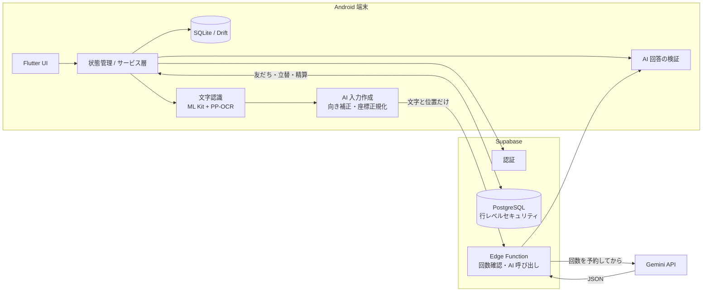

# DULL — 家計簿・シフト給与・立替アプリ（ポートフォリオ）

DULL は、個人で開発している Android 向けの家計簿アプリです（Flutter 製）。
このリポジトリは **紹介用** で、アプリ本体のソースコードは非公開です。
しくみの説明と、説明のために新しく書いた小さなサンプルコードだけを置いています。

## DULL でできること

- **家計簿**: 収入・支出の記録、カテゴリ別の集計（予算・資産・検索などは公開に向けて開発中）
- **シフトと給与**: アルバイトのシフトを登録すると、勤め先ごとの時給・勤務時間・交通費から、支給月ごとの給与の見込みを計算
- **立替・割り勘**: 友だちと立て替えたお金を記録し、品目ごと・全体での割り勘、精算と取り消しまでを双方で管理
- **レシート AI 読み取り**: レシートを撮影すると、店名・日付・合計・品目を自動で入力（有料プラン）
- **バックアップ**: 端末内データの書き出し・読み込み（検証付き）

## 技術構成

| 分野 | 使っているもの |
|---|---|
| アプリ | Flutter / Dart（Android。iOS は今後） |
| 端末内データ | SQLite（Drift）。オフラインでも全機能の記録ができる |
| サーバー | Supabase（PostgreSQL + 行レベルセキュリティ、RPC、Edge Functions / TypeScript・Deno） |
| レシート | 端末内文字認識（Google ML Kit、PP-OCR を ONNX Runtime で実行）→ サーバー経由で Gemini |
| テスト | Flutter のテスト 6,000 件以上、pgTAP（DB）、Deno（Edge Functions）、実機確認 |
| 開発 | Claude Code のマルチエージェント、OpenAI Codex（隔離環境）、レビューと結びついたコミットゲート |

## 全体構成



- 家計簿やシフトなど個人のデータは **端末の中** に保存し、友だちとの立替・精算のように相手と共有するものだけをサーバーに置きます。
- サーバー側の重要な処理（精算、取り消し、退会、AI の利用回数）は、データベースの関数としてまとめ、権限とテスト（pgTAP）で守っています。
- AI の API キーはサーバーの秘密情報としてだけ保持し、アプリには入れていません。

## 見どころ

1. **レシート AI 読み取り** — 端末の文字認識を AI の材料にし、横向き写真の補正、根拠つきの構造化回答、
   端末での検証、正解データと取り分けた評価用セットによる精度評価まで行っています。
   → [docs/receipt-ai.md](docs/receipt-ai.md)
2. **AI エージェントによる開発ループ** — 役割を分けたエージェント、隔離環境での Codex、
   レビュー結果を commit 内容の指紋に結びつけて署名するコミットゲート、実機データを守るルール。
   → [docs/ai-agent-workflow.md](docs/ai-agent-workflow.md)
3. **給与計算の正しさ** — 「お金に小数（浮動小数点）を使わない」「円未満は勤め先・支給月の合計でだけ切り捨てる」「取り消したシフトは含めない」
   「交通費は基本給と分ける」といった決まりを、変えてはいけない約束（不変条件）として文書化し、テストで固定しています。

## サンプルコード

すべて説明用に新しく書いたもので、データは架空です。Python 3.10 以上で、追加ライブラリなしで動きます。

| ファイル | 内容 |
|---|---|
| [samples/receipt_ai/receipt_pipeline_sample.py](samples/receipt_ai/receipt_pipeline_sample.py) | 横向き判定・回転・傾き補正 → AI 入力作成 → AI 回答の検証 |
| [samples/receipt_ai/eval_sample.py](samples/receipt_ai/eval_sample.py) | 修正なし率・修正回数・品目 F1・サイレントエラーと信頼区間 |
| [samples/agent_gate/commit_gate_sample.py](samples/agent_gate/commit_gate_sample.py) | ステージ内容の指紋と HMAC 署名つき判定の検証（汎用版） |
| [samples/agent_gate/guard_sample.py](samples/agent_gate/guard_sample.py) | 危険なコマンドを止めるガードの例と自己テスト |

```sh
python samples/receipt_ai/receipt_pipeline_sample.py
python samples/receipt_ai/eval_sample.py
python samples/agent_gate/guard_sample.py --self-test
```

## 公開していないもの

アプリ本体のコード、AI への指示文（プロンプト）、実際のレシートや正解データ、評価用に取り分けたデータ、
サーバーの接続情報・鍵などは含めていません。

## 作者

ublf（個人開発）
