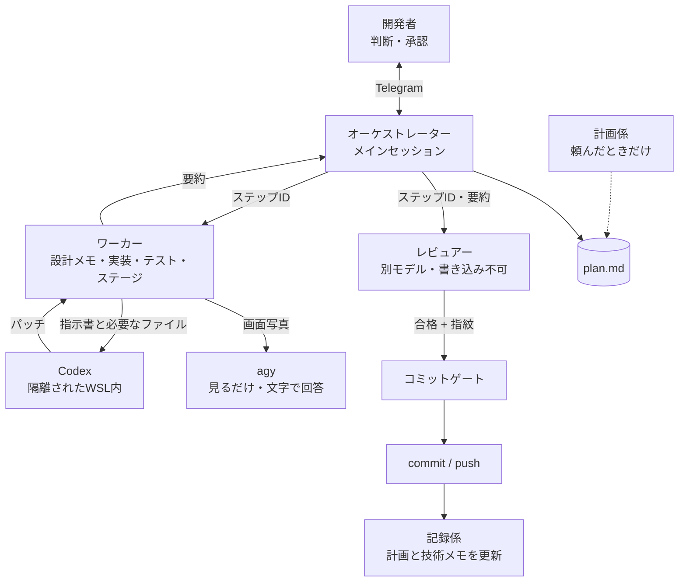
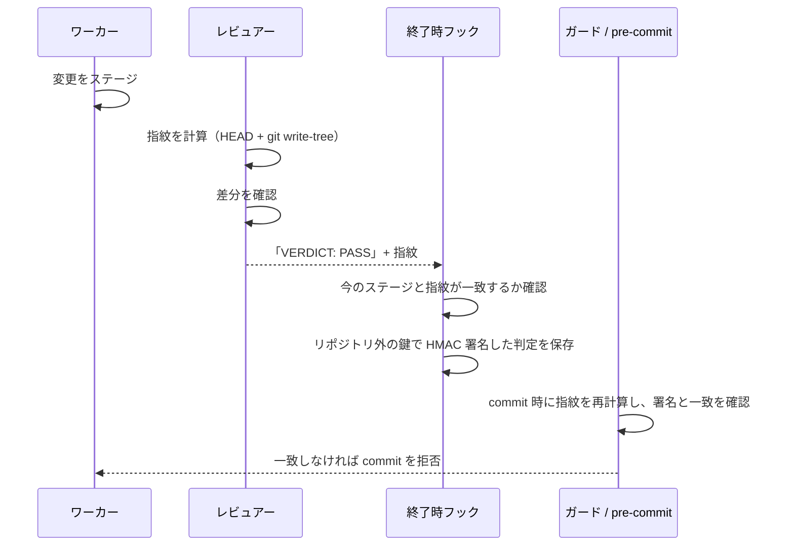

# AI エージェントによる開発の進め方

DULL は、開発者（私）が方針と判断を担い、実装・確認・記録の多くを AI エージェントに任せて作っています。
ここでは、その役割分担と、**AI に任せても壊れない・漏れない** ようにした安全装置を説明します。

使っているもの: Claude Code（メインとサブエージェント）、OpenAI Codex（コード作成の補助）、
agy（Gemini、画面写真の確認の補助）、Telegram（外出中の連絡）。

## 役割分担

| 役割 | やること | やらないこと |
|---|---|---|
| オーケストレーター | 計画から次のステップを選び、各エージェントを呼び、結果を開発者に短く伝える | ソースを読む、実装する |
| ワーカー | 1 ステップ分の設計メモ（brief）を書き、実装し、テストを実行し、変更したファイルを 1 つずつステージする | commit、push、開発者への連絡 |
| レビュアー | ステージされた差分を、書いた本人とは別のモデルで確認し「合格 / 不合格」と理由を返す | ファイルの書き込み（ツール自体を持たない） |
| 記録係 | 完了したステップを計画表と技術メモに反映する | コードの変更 |
| 計画係 | 開発者が頼んだときだけ、計画の分割・並べ替えを行う | 通常のループでは動かない |

ループは「ステップを選ぶ → ワーカー → レビュー → 合格なら commit/push → 記録 → 次へ」を自動で続けます。
次の場合だけ止まり、Telegram で開発者に **やることを番号付きで** 聞きます。

- 利用者データの書き換え、データベースの形の変更、コードやテストの削除（事前に「OK」をもらう）
- 新しい依存ライブラリ、本番環境の設定、課金を伴う操作、仕様や文言の判断
- 端末のロック解除など、人の手が必要なとき
- 同じ失敗が 3 回続いたとき

Telegram のメッセージには、秘密情報・金額・店名・レシートの文字・個人情報・コードを入れない決まりです。

## Codex への受け渡し（隔離環境）

コードを書く作業の多くは Codex に任せていますが、Codex は開発用 PC とは別の **専用の WSL（Linux）環境** で動かします。

- 受け渡しは専用スクリプトだけを通します。Codex 側はサンドボックス有効・ネットワークなし（テスト実行もループバックのみの名前空間）。
- 送る前に全ファイルを **秘密情報スキャン**（API キー、トークン、メールアドレス、接続先 URL など）にかけ、1 つでも見つかれば送りません。
- 評価用に取り分けたレシートの ID が含まれていても送りません（評価を公正に保つため）。
- 戻ってきたパッチは、変更してよい範囲（アプリのコードとテストなど）か、ファイルの削除や危険な処理（プロセス起動・通信など）を含まないかを機械的に確認し、さらにワーカーが全文を読んでから適用します。
- 依存関係、署名、ドキュメント、端末での確認、commit は Codex に任せません。
- Codex に指示を出す前には、毎回開発者に一行で通知します。

## agy による画面チェック

画面の見た目の確認では、実機のスクリーンショットを agy（Gemini）に見せて、文字のはみ出しなどを指摘してもらいます。

- agy は画像を見て文字で答えるだけで、ファイル操作・コマンド・Web・ツールは使えない設定で動かします。
- 送信側スクリプトは、agy のテレメトリ設定がオフでないと実行を拒否します。1 ステップ 3 回まで。
- agy の「問題なし」は参考意見にとどめ、実機確認や開発者の確認の代わりにはしません。
- レシートの文字が写る画面は撮りません。写真はコミットせず、Telegram にも送りません。

## コミットゲート（レビューと commit を結びつける仕組み）

「レビューに合格した内容」と「実際に commit される内容」が 1 バイトでも違えば commit できないようにしています。

- **指紋** = 「HEAD のコミット ID」と「ステージ内容のツリー ID（`git write-tree`）」をまとめた SHA-256。
  `git write-tree` は commit で実際に記録されるツリーそのものなので、差分の表示形式に左右されません。
- **判定の署名**: レビュアーは書き込みツールを持たず、レビュアーが終了したときに動くフックだけが判定ファイルを書きます。
  判定はリポジトリの外にある鍵で HMAC 署名され、エージェントのツールからは鍵に触れられないよう権限で塞いでいます。
- **ガード（PreToolUse フック）**: シェルやファイル編集の前に毎回動き、次のようなものを止めます。
  有効な判定がない commit、`--no-verify` や `--amend`・`-a`、強制 push、履歴の書き換え、`git add .` のような一括ステージ、
  破壊的なコマンド、個人用の設定フォルダへのアクセス、ゲートやエージェント設定そのものの編集。
- **pre-commit フック**: 同じ確認を git 側でもう一度行います（二重化）。
- ゲート・ガード・エージェント設定の変更は開発者だけが行います。AI は変更案を作り、開発者が手でコピーします。
- 回帰テストを用意し、ガードのルールを変えても既存のケースが壊れないことを確認しています。
- 限界: ガードは文字列の照合なので、間接的な実行までは完全に防げません。そのため権限設定・レビュー・pre-commit と重ねて使っています。

実際のガードでは、たとえば次のものを止めています。

- `hooksPath` という文字がどこかに入ったコマンド（フックを無効にする設定の変更）
- `--no-verify` などのフラグを付けた commit
- `+main` のような `+` 付きの指定や `--force` / `-f` を使った強制 push、削除や `main` / `master` への push

また、フラグに関係なく、すべての `git commit` は「今ステージされている内容と一致する有効なレビュー判定」がなければ止まります
（pre-commit フックでも同じ確認をします）。push はその判定を通った commit のあとにだけ行います。

下のサンプルはこの考え方を短く示すためのもので、実物のガードやゲートのコードではありません。

サンプル（DULL の実物ではなく、考え方を示す汎用版）:

- [`samples/agent_gate/commit_gate_sample.py`](../samples/agent_gate/commit_gate_sample.py): 指紋の計算、HMAC 署名、検証
- [`samples/agent_gate/guard_sample.py`](../samples/agent_gate/guard_sample.py): 危険なコマンドを止めるガードと自己テスト

## 実機を操作するときのデータ保護

開発用のスマートフォン（Pixel）を AI が adb で操作して確認することがあります。実際の家計簿データが入っているため、次を守ります。

- アプリの再インストールやデータ消去はしない。`flutter run` は使わず、ビルドした APK を上書きインストール（`adb install -r`）する。
- 画面の自動操作ツール（`uiautomator dump`、`monkey`）は使わない。過去に画面の自動回転設定が勝手に変わったため。
- 回転設定やクイック設定には触れない。操作の最初と最後に自動回転の設定値を読み、変わっていれば元に戻す。
- 操作するのは DULL の画面だけ。レシートの文字が写る画面は撮影しない。
- データベースの形の変更や利用者データの書き換えは、開発者の承認を得てから行う。
- 本番サーバーへの反映は開発者だけが行う（AI は開発用サーバーまで）。

## 結果として

- 1 ステップごとに「設計メモ → 実装 → テスト → 別モデルのレビュー → commit → 記録」がそろうので、
  履歴を追えば「なぜこう作ったか」が分かります。
- 開発者は Telegram で「OK」「続けて」と答えるだけで、外出中も開発が進みます。
- テストは 6,000 件以上あり、すべてのステップで全件実行しています。
