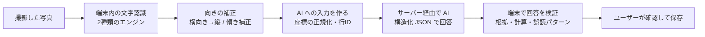

# レシートAI読み取りのしくみ

DULL では、レシートを撮影すると「店名・日付・合計・品目ごとの名前と金額」を自動で入力します。
ここでは、写真が家計簿のデータになるまでの流れと、精度をどう測っているかを説明します。

> 注意: AI に渡している指示文（プロンプト）の本文、実際のレシート画像・文字・店名・金額、
> 正解データ、評価用に取り分けたレシートの情報は、このリポジトリには含めていません。
> サンプルコードのデータはすべて架空です。

## 全体の流れ

### 1. 端末内の文字認識は「AI への材料」

写真は端末の中で 2 種類の文字認識エンジン（Google ML Kit と PP-OCR）にかけます。
得られるのは「文字列」と「写真上の位置（四角形）」の組です。

以前は端末だけで金額や品目を読み取るルールも持っていましたが、AI の方が精度が高かったため、
現在は端末の文字認識を **AI に渡す材料としてだけ** 使っています。
（AI を使えないときは、勝手に推測せず「未整理」として残し、手入力か読み直しを選べるようにしています。）

写真そのものは AI に送らず、**文字と位置だけ** を送ります。通信量と費用を抑えるためです。

### 2. 向きと座標の扱い

評価中に、新しく集めたレシートの約半数（52%）が **横向きに撮られていた** ことが分かりました。
横向きのままだと、AI は「名前と金額が同じ行にある」という関係を取り違えます。

そこで AI に渡す前に次の処理をしています。

1. **横向きの判定**: レシートの文字の行は横に長いはずです。行の四角形の「幅 ÷ 高さ」の中央値が
   1 未満なら（縦長の行ばかりなら）横向きと判断します。2 つのエンジンの両方がそう判断したときだけ回転します。
2. **90 度回転**: 文字が下向きに流れている写真は、座標を `(x, y) → (y, 幅 − x)` と変換して縦向きに戻します。
3. **傾き補正**: 回転させた写真だけ、行の傾きの中央値を求めて水平に戻します。
   もともと縦向きの写真にも補正をかけると、かえって悪くなる例があったため、対象を絞っています。
4. **座標の正規化**: 写真の大きさで割って 0〜1 の割合にし、写真からはみ出す読み取り結果は捨てます。
   2 つのエンジンの結果を同じ枠に重ね、0〜1000 の整数にそろえます。

### 3. AI への入力

- 行ごとに短い ID（エンジン 1 は `M1, M2, …`、エンジン 2 は `P1, P2, …`）を付け、文字と位置をまとめた JSON にします。
- 行数・1 行の長さ・全体のサイズに上限を設け、超える場合は送りません。
- AI の呼び出しはアプリから直接ではなく、サーバー（Supabase Edge Function）を経由します。
  API キーはサーバー側にだけ置き、ログイン・同意・月の利用回数をサーバーで確認してから AI を呼びます。
- AI には決まった形（JSON スキーマ）で答えてもらいます。品目ごとに
  「どの行（ID）から読んだか」という **根拠の行 ID** も返してもらいます。
- 1 回目の呼び出しで店名・日付・合計・品目を読み、2 回目の軽い呼び出しで品目のカテゴリを提案します。
- 目標は「1 枚あたり約 0.5 円で、できるだけ正確に」です。

### 4. AI の回答を端末で検証する

AI の答えをそのまま信じず、端末で次のような確認をします。

| 確認 | 内容 |
|---|---|
| 根拠の確認 | 根拠として示された行 ID が実在するか。その行の文字に、その金額が本当に書かれているか |
| 計算の確認 | 品目の合計・税額・値引きと、印字された合計が合うか |
| 「¥」を「4」と読む誤り | 文字認識は `¥120` を `4120` と読むことがあります。頭の 4 を外すと計算が合う、など独立した証拠があるときだけ直します |
| 名前 | AI が付けた品名を勝手に書き換えたり消したりはしません。文字認識の結果に見当たらない名前は「要確認」の印を付けます |
| 日付 | 年が印字されていないときは撮影日から年を補い、そのことを画面に小さく表示します |

直せないものは **直さずに印を付けて、ユーザーに確認してもらう** のが基本方針です。
「間違っているのに警告が出ない（サイレントエラー）」を一番減らしたい誤りとして数えています。

サンプル: [`samples/receipt_ai/receipt_pipeline_sample.py`](../samples/receipt_ai/receipt_pipeline_sample.py)
（横向き判定 → 回転 → 入力作成 → 検証、架空データ。`python receipt_pipeline_sample.py` で実行できます）

## 精度の測り方

### 方法

- 自分で集めたレシートについて、人の手で正解データ（店名・日付・合計・品目）を作りました。
  書き起こしのルールを文書にし、別の AI セッションによる独立したチェックと突き合わせて確定しています。
- アプリと同じ処理を PC で再現する評価用の仕組み（ハーネス）を作り、保存した文字認識結果を何度でも同じ条件で読み直せるようにしました。
  端末（Dart）と評価用（Python）の検証ロジックが同じ結果を出すことも確認しています。

### 指標

- **修正なし率**: ユーザーが何も直さずに保存できたレシートの割合
- **修正回数**: 1 枚あたり何か所直す必要があるか（品目の抜け・余分・金額違い・合計違い・店名違い）
- **品目 F1**: 品目（名前と金額）の一致度
- **サイレントエラー**: 警告なしに間違っている数

### 過学習を防ぐ工夫

- **開発用と評価用を最初に分ける**: 改善の検討は開発用だけで行い、評価用のレシートは調整に使いません。
- **評価用は凍結した版で一度だけ測る**: アプリの版を固定し、除外条件も事前に決めてから採点しました。
- **評価用の情報は AI にも渡さない**: 開発を手伝う AI（Codex など）に渡すファイルは自動検査し、
  評価用レシートの ID が含まれていれば送信を止めます。
- **ばらつきを考える**: 枚数が少ないため信頼区間（Wilson）を併記し、同じ条件で複数回実行して、差がばらつきの範囲内なら「効果なし」と判断します。

サンプル: [`samples/receipt_ai/eval_sample.py`](../samples/receipt_ai/eval_sample.py)（指標と信頼区間の計算、架空データ）

### 結果（集計値のみ）

- 初期の仕様で、品目 F1 は開発用 92% / 評価用 76%、カテゴリ正解率は 91% / 85%。
- 新しく集めた未見のレシートでの評価では、修正なし率が開発用 59% に対して 35%（95% 信頼区間 19〜55%）にとどまり、
  合計金額の正解率は AI なし 35% → AI あり 91% でした。
  開発用と未見の差を分析した結果、横向きの写真と「金額が品名の半行上に印字される」飲食店のレシートが主な原因と分かり、
  前述の向き補正につながりました。
- 未見のセットは原因分析に使ったため、その後は開発用に組み入れました。最終確認には、調整に一度も使っていない
  別の評価用セットを使います。

### 学んだこと

- プロンプトに説明を足すより、**入力（向き・傾き）を正しく整える方が効果が大きい** ことが多かった。
- AI の答えを検証して「怪しいものに印を付ける」層があると、ユーザーが安心して使える。
- モデルの比較（Gemini と Claude Haiku など）は、同じ入力・同じ採点で、費用と一緒に比べる。
